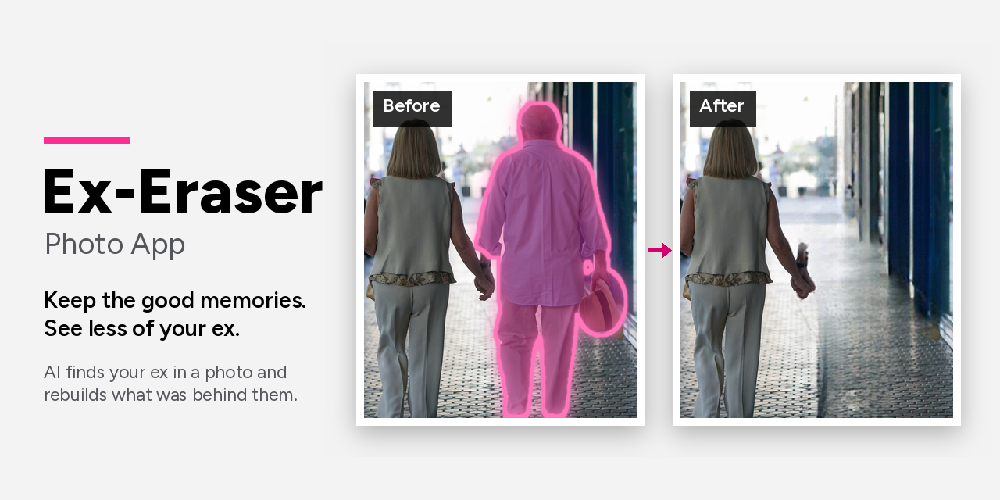
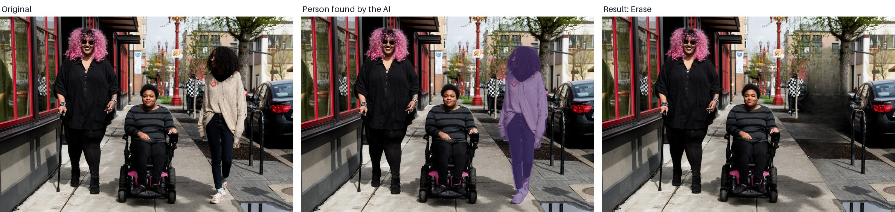

  

  
  
  

  
  
  
  
  
  
  

# Ex-Eraser Photo App

A photo app that helps people keep their good memories after a breakup while seeing less of their ex. The tone is healing: calm, steady and neutral about the person.

The MVP is a portfolio concept for conversation design and agentic AI. The final version is planned as an App Store product.

## See it in action

  

  <strong><a href="demo/video/ex-eraser-demo.mp4">Watch the full 30-second video with sound</a></strong> 
  Also available <a href="demo/video/ex-eraser-demo-captions.mp4">with captions you can turn on and off</a>, or as caption files (<a href="demo/video/captions.srt">.srt</a>, <a href="demo/video/captions.vtt">.vtt</a>).

**Try it yourself:** [open the hosted print demo](https://claude.ai/artifact/5BWzBqsb9aesSUv9AToVLp). Pick your edited photos and order prints at a Walgreens. It runs in demo mode, so no real orders are placed.

## In plain words

Imagine you have a favorite photo from a fun day, but your ex is in it. You'd like to keep the photo without having to see them. Ex-Eraser is an app that fixes that.

This project has five parts:

1. **The plan.** A written spec covering what the app does, how it talks to people (kind and calm, since breakups hurt), and five ways to handle a photo: fade them, crop them out, erase them, replace them with a soft shape, or delete the photo.
2. **The magic eraser.** A real working tool. One AI finds the person in the photo, and a second AI paints in what was behind them, such as the sidewalk, the wall or the street. It's tested on real photos of real people of different ages, ethnicities and abilities.
3. **A clickable demo.** A website where you pick your edited photos and order prints at a Walgreens. Checkout is pretend, but it looks and works like a real app.
4. **A 30-second video.** It shows the eraser in action, with a voice and captions.
5. **The story behind it.** A case study explaining the design choices: why every AI edit is labeled honestly, why the app suggests another option when erasing won't look good, and how it could plug into photo printing services like CVS and Shutterfly.

In short, the project designs the whole experience (the words, the rules and the look) and builds enough of it to show it really works.

## What it does

The user chooses a person. The app finds their photos with on-device face matching and suggests one of five modes for each photo:

| Mode | What happens |
| --- | --- |
| Fade | Photos stop appearing in Memories, widgets and slideshows. Nothing is edited. |
| Crop | The person is trimmed out of the frame. |
| Erase and fill | AI removes the person and rebuilds the background. |
| Replace | The person is swapped for a soft silhouette, the user's pet or a calm everyday object. |
| Delete | The photo is removed after a final review, and stays recoverable for 30 days. |

Originals are always kept, every edit is labeled in the photo's metadata, and face data never leaves the phone. When the user is done, they can print a few favorites for same-day pickup at Walgreens.

## Proof on real photos

The core idea works today. An open-source pipeline found and removed one person from real, openly licensed photos of people of different ages, ethnicities and abilities.

The [proof page](demo/README.md) shows all six results, how the eraser rebuilds the background, a comparison of four fill models, and what worked and what didn't.

## Try the demo

There are three ways to try the print step demo, from easiest to most hands-on. All of them run in demo mode, so no real orders are placed.

1. **Open the link.** Nothing to install: [open the hosted demo](https://claude.ai/artifact/5BWzBqsb9aesSUv9AToVLp). It runs entirely in your browser.
2. **Double-click to run it on your Mac.** Install [Node.js](https://nodejs.org) once, [download this repo](https://github.com/jkelleman/ex-eraser-photo-app/archive/refs/heads/main.zip), unzip it, and double-click **Start Demo** in the `prototype` folder. The demo opens in your browser.
3. **Use Terminal** if you want to connect to Walgreens or change the code. See the [prototype README](prototype/README.md).

## Roadmap

The next round of work makes erase and the soft silhouette better and more honest: protecting the people who stay, sharper outlines, catching belongings and shadows, checking every fill automatically, a silhouette built on the rebuilt background, and a scoring guide to measure progress. See the [roadmap specs](docs/15-edit-quality-roadmap.md).

## Repo contents

### Product
- [Product plan](docs/01-product-plan.md): landscape, platform constraints, modes, edit labeling and hard cases
- [Voice and journey](docs/02-voice-and-journey.md): voice principles and the onboarding flow diagram
- [Partner integrations](docs/11-partner-integrations.md): connecting to print services like CVS, Walgreens and Shutterfly
- [Packaging as an app](docs/13-packaging-as-an-app.md): steps from the web demo to the App Store
- [Sharing a beta with TestFlight](docs/14-testflight.md): how to give testers a one-tap install link, for later
- [Roadmap specs: erase and soft silhouette](docs/15-edit-quality-roadmap.md): what to improve next and how to measure it

### Conversation design and copy
- [Onboarding](docs/03-onboarding.md): the eight-step script and the "How does it work?" explainer
- [Triage screen](docs/04-triage.md): batch review, suggestion rules and batch copy
- [Replace picker](docs/05-replace-picker.md)
- [The vault](docs/06-vault.md)
- [Settings](docs/07-settings.md)
- [Return visits and notifications](docs/08-return-visits.md)
- [Error and empty states](docs/09-error-states.md)
- [Accessibility pass](docs/10-accessibility.md)
- [Print step](docs/12-print-step.md)

### Proof
- [Person removal on real photos](demo/README.md): before, outline and after for six edits
- [Pipeline script](tools/erase_person.py) and [photo credits](demo/CREDITS.md)
- [Demo video](demo/video/ex-eraser-demo.mp4), with [captions](demo/video/captions.srt)

### Prototype
- [Print step demo](prototype/README.md): a working web demo that sends cleaned-up photos to Walgreens, with a mock mode that needs no credentials

### Agent
- [Suggestion agent instructions](agent/suggestion-agent-prompt.md)
- [Eval plan](agent/eval-plan.md)

### Portfolio
- [Case study](case-study.md)
- [Open questions](docs/open-questions.md)

## Next to write

- [x] A working demo of the print step
- [x] A 30-second demo video with voice and captions
- [x] Roadmap specs for erase and soft silhouette
- [ ] A clickable prototype of onboarding and triage
- [ ] Outreach to CVS and Shutterfly, using the demo and the case study
- [ ] A TestFlight beta with a public link ([how](docs/14-testflight.md))
- [ ] A usability test plan for the check-in and triage copy
- [ ] App Store listing copy and the App Privacy details
