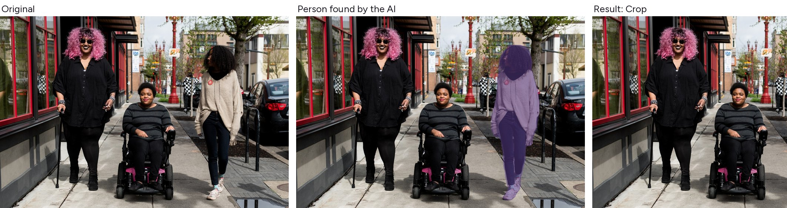
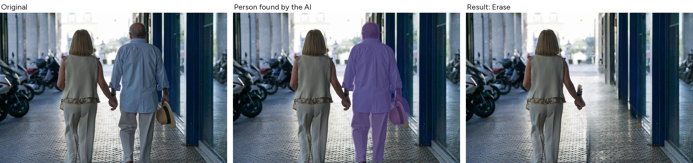
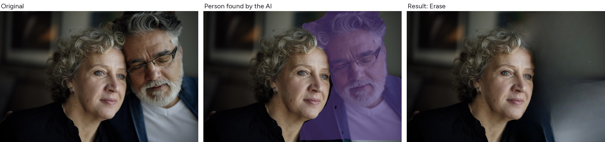
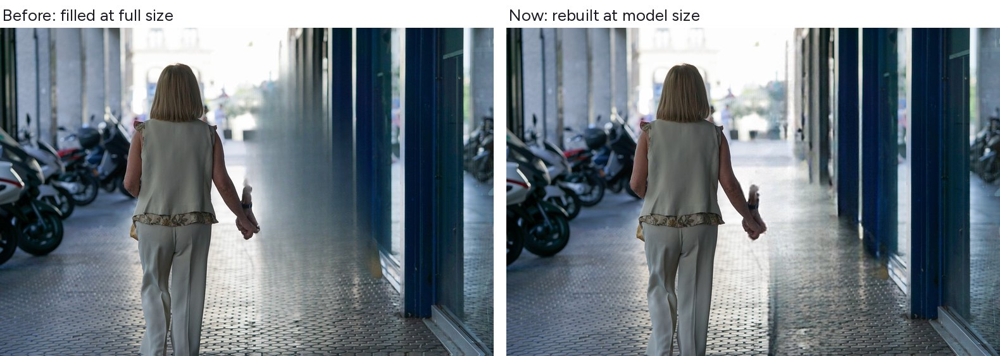
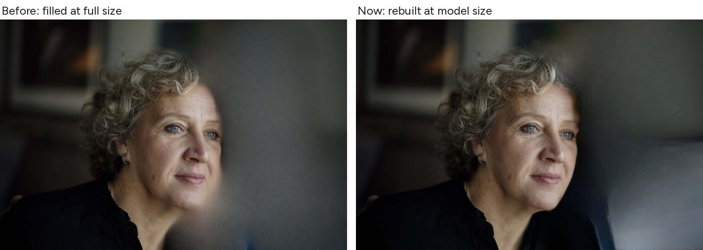
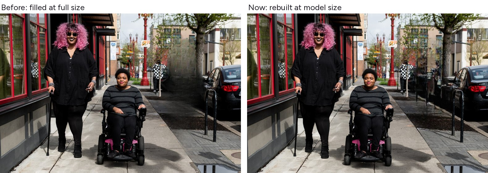

# Proof: removing a person from real photos

These are real, openly licensed photos of real people, edited by the pipeline in [`tools/erase_person.py`](../tools/erase_person.py). They show that the core idea works today, on a laptop, with open-source models.

The set covers a range of ages, ethnicities and abilities: Black disabled friends (one uses a power wheelchair, one walks with a cane), an Asian bride and Black groom, and two older couples.

## How it works

1. **Find people.** YOLOv8 instance segmentation outlines every person in the photo.
2. **Pick the person.** Here, by position. In the app, the person is chosen by face during onboarding.
3. **Edit.** LaMa, an image-filling model, rebuilds the background where the person was. It works on a square crop around the person, about 1.6 times their size, scaled to 512 pixels: the size LaMa was trained at. The fill is scaled back up, given grain that matches the photo, and blended in. Crop and silhouette are the other options.
4. **Label.** Each edited JPEG carries the IPTC Digital Source Type `compositeWithTrainedAlgorithmicMedia` ("edited with generative AI") in its metadata, and a JSON edit record is saved beside it.

Each image below shows the original, the outline the AI found, and the result.

## Results

### Erase: friend walking on the right


The curb, planter, tree trunk and building fronts continue through the space where she was walking. The two friends stay exactly as they were.

### Crop: same photo



When the person is at the edge of the frame, a crop leaves no trace at all.

### Erase: groom at a wedding


The bride walks the aisle alone. The steps, candle stands and aisle runner carry through where he stood. One touch-up removed a shoe the outline missed. Through her veil there's still a faint trace of his shoulder, because the veil belongs to her and stays in the photo. This source photo is small (633 × 950), so the fill is softer than in the others.

### Erase with one touch-up: older couple walking



The man was holding a hat outside his detected outline, so the first pass left it floating. One touch-up, a box over the hat, fixed it. This is why the app needs a "Missed a spot? Brush over it" tool. The pillars, shop windows and paving now continue down the arcade where he walked. A small bit of his hand is still visible where they were holding hands.

### Erase: close-up



Their heads touch, and he fills half the frame. The wall, the edge of the couch and the shadow behind her are rebuilt, and her face stays intact. A tighter outline (8 pixels instead of 18) kept the fill from cutting into her cheek.

### Soft silhouette: same close-up


Some people want to keep a sense that someone was there. Here he becomes a soft, frosted shape that can't be recognized, and she stays sharp.

## Rebuilding the missing pieces

The first version of erase ran LaMa on the whole photo. On large gaps, that left a smear of nearby colors. Running the model on a crop at its training size lets it continue edges and textures through the gap instead.







Four open models were compared on all four photos, each run the same way: LaMa, MAT, MI-GAN and FcF. LaMa gave the most believable result every time. The other three often invented things that weren't there, like a red blob on the sidewalk or a stranger in the wedding aisle. For a healing app, an invented object is worse than a soft patch, so LaMa stays.

The next step up is a diffusion model guided by the rest of the photo, such as Stable Diffusion inpainting or Apple's on-device image tools. Those can draw finer detail, but they're slower, larger and more likely to invent. They're worth testing for the App Store version, with the same rule: nothing new should appear in the photo.

## What this shows about the design

- **Erase works well** when the person is separate from the others and the background is ordinary: streets, walls, floors.
- **Crop is best** when the person is at the edge of the frame.
- **Close-ups can now be erased.** Offer erase first, and keep the silhouette as an option for people who want a trace of the moment. The [triage screen](../docs/04-triage.md) rule now does this.
- **A touch-up tool is necessary.** Things people hold (hats, bags, hands) can fall outside the outline.
- **Larger, sharper photos give better fills.**

## Run it yourself

```bash
python -m venv .venv && source .venv/bin/activate
pip install -r tools/requirements.txt
pip install --no-deps simple-lama-inpainting

python tools/erase_person.py demo/originals/friends-street.jpg --list
python tools/erase_person.py demo/originals/friends-street.jpg --person 4 --mode erase --out demo/results
python tools/erase_person.py demo/originals/older-couple-walking.jpg --person 2 --touch-up 1085 590 1245 805 --out demo/results
python tools/erase_person.py demo/originals/wedding-aisle.jpg --person 3 --touch-up 370 770 450 850 --out demo/results
python tools/erase_person.py demo/originals/older-couple-closeup.jpg --person 2 --grow 8 --out demo/results
python tools/erase_person.py demo/originals/older-couple-closeup.jpg --person 2 --mode silhouette --grow 24 --out demo/results
python tools/make_proof.py   # rebuilds the images on this page
```

The models download on the first run. After that, each edit takes about 10 seconds on a laptop CPU, most of it loading the models.

## Licenses

All photos are used under open licenses that allow editing. See [CREDITS.md](CREDITS.md).

The pipeline uses YOLOv8 from Ultralytics, which is licensed under AGPL-3.0. That's fine for this demo. For the App Store product, either use a permissively licensed segmentation model (Apple's Vision framework on iPhone is the natural choice) or get an Ultralytics commercial license.
