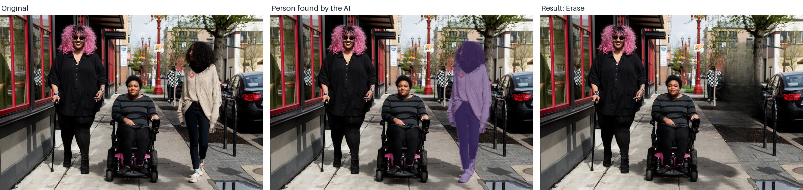
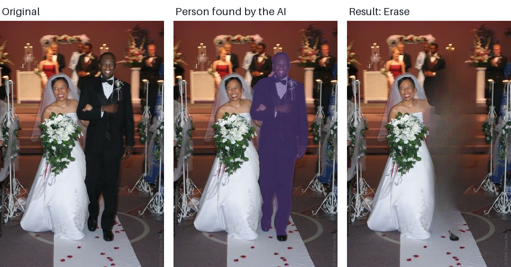
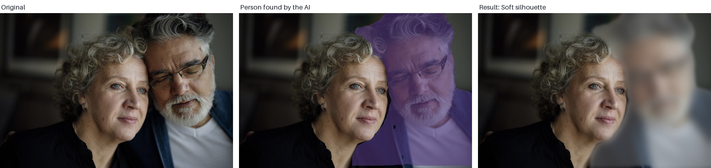

# Proof: removing a person from real photos

These are real, openly licensed photos of real people, edited by the pipeline in [`tools/erase_person.py`](../tools/erase_person.py). They show that the core idea works today, on a laptop, with open-source models.

The set covers a range of ages, ethnicities and abilities: Black disabled friends (one uses a power wheelchair, one walks with a cane), an Asian bride and Black groom, and two older couples.

## How it works

1. **Find people.** YOLOv8 instance segmentation outlines every person in the photo.
2. **Pick the person.** Here, by position. In the app, the person is chosen by face during onboarding.
3. **Edit.** LaMa, an image-filling model, rebuilds the background where the person was. Crop and silhouette are the other options.
4. **Label.** Each edited JPEG carries the IPTC Digital Source Type `compositeWithTrainedAlgorithmicMedia` ("edited with generative AI") in its metadata, and a JSON edit record is saved beside it.

Each image below shows the original, the outline the AI found, and the result.

## Results

### Erase: friend walking on the right



The sidewalk, street and parked car are rebuilt where she was walking. The two friends stay exactly as they were.

### Crop: same photo


When the person is at the edge of the frame, a crop leaves no trace at all.

### Erase: groom at a wedding



The bride walks the aisle alone. The area where he stood is a little soft, because this source photo is small (633 × 950).

### Erase with one touch-up: older couple walking


The man was holding a hat outside his detected outline, so the first pass left it floating. One touch-up, a box over the hat, fixed it. This is why the app needs a "Missed a spot? Brush over it" tool. A small bit of his hand is still visible where they were holding hands.

### Soft silhouette: close-up



Their heads touch, and he fills half the frame. Erasing him leaves a blurry patch, so the app suggests a silhouette for close-ups. Here he becomes a soft, frosted shape that can't be recognized, and she stays sharp.

## What this shows about the design

- **Erase works well** when the person is separate from the others and the background is ordinary: streets, walls, floors.
- **Crop is best** when the person is at the edge of the frame.
- **Close-ups need a different answer.** The silhouette rule in the [triage screen](../docs/04-triage.md) holds up.
- **A touch-up tool is necessary.** Things people hold (hats, bags, hands) can fall outside the outline.
- **Larger, sharper photos give better fills.**

## Run it yourself

```bash
python -m venv .venv && source .venv/bin/activate
pip install -r tools/requirements.txt
pip install --no-deps simple-lama-inpainting

python tools/erase_person.py demo/originals/friends-street.jpg --list
python tools/erase_person.py demo/originals/friends-street.jpg --person 4 --mode erase --out demo/results
python tools/erase_person.py demo/originals/older-couple-walking.jpg --person 2 --touch-up 1085 590 1245 805 --out demo/results
python tools/erase_person.py demo/originals/older-couple-closeup.jpg --person 2 --mode silhouette --grow 24 --out demo/results
```

The models download on the first run. Each edit takes about 30 seconds on a laptop CPU.

## Licenses

All photos are used under open licenses that allow editing. See [CREDITS.md](CREDITS.md).

The pipeline uses YOLOv8 from Ultralytics, which is licensed under AGPL-3.0. That's fine for this demo. For the App Store product, either use a permissively licensed segmentation model (Apple's Vision framework on iPhone is the natural choice) or get an Ultralytics commercial license.
