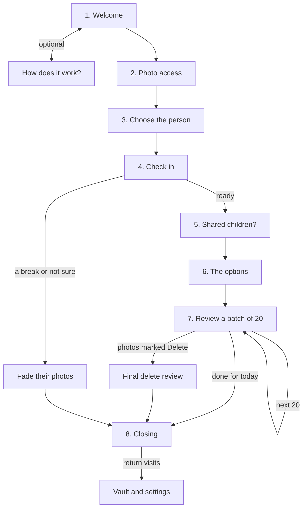

# Voice and journey

## Voice principles

- **Calm and steady.** Short sentences, no exclamation points, no jokes about the ex.
- **The user sets the pace.** Every screen has a way to pause or skip.
- **Neutral about the person.** The app never judges them. It calls them by the name the user gives, or "this person."
- **Plain about safety.** Say clearly what happens to photos and face data, every time it matters.

## Journey at a glance

The check-in sets how much someone takes on today.

People who need a break go straight to Fade and finish early. Everyone else reviews photos in batches of 20 until they're done for the day, and photos marked Delete get a final review first.
