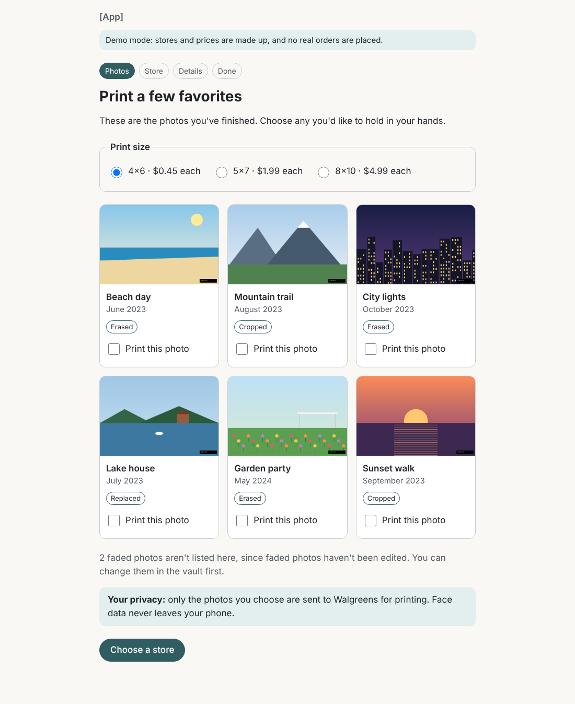
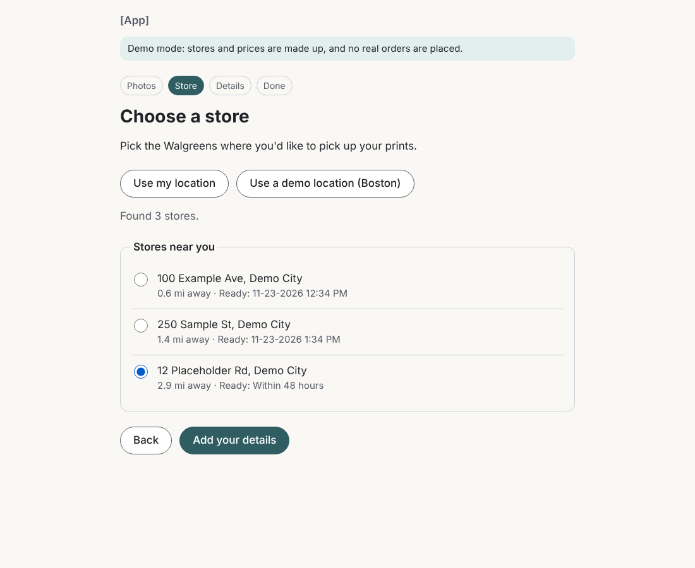
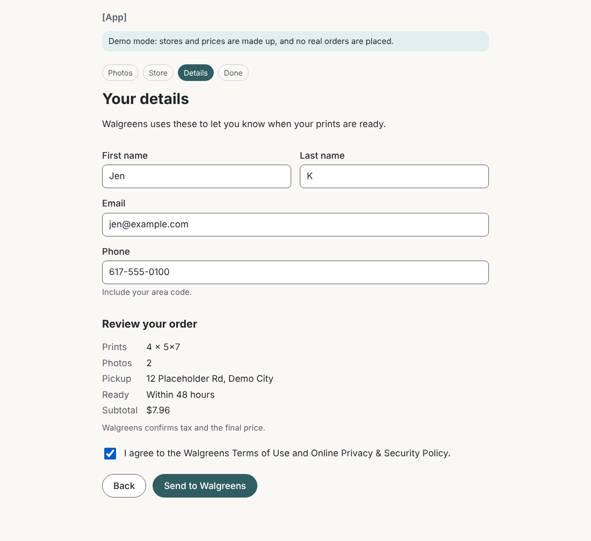
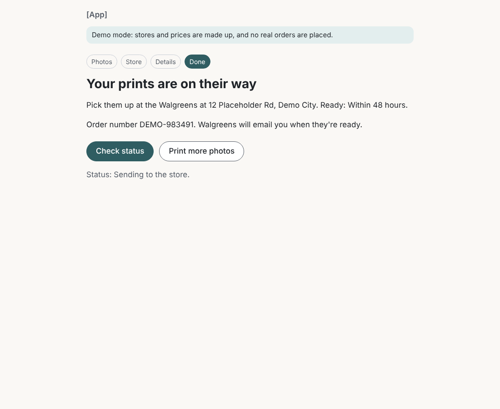

# Print step demo

A working demo of the print step: after cleaning up their photos, a person picks a few favorites and sends them to Walgreens for same-day pickup. It's built to show partners like CVS and Shutterfly how the flow works, alongside the [case study](../case-study.md).

The demo is a small web app. The real product would be a native iPhone app (see [Packaging as an app](../docs/13-packaging-as-an-app.md)), but the flow, copy and Walgreens integration carry over.

| Choose photos | Choose a store | Your details | Done |
| --- | --- | --- | --- |
|  |  |  |  |

The demo photos are illustrations with no people in them. Dark mode is supported too ([screenshot](screenshots/4-done-dark.png)).

## Run it

You need [Node.js](https://nodejs.org) 18 or newer. There's nothing to install.

```bash
cd prototype
npm start
```

Open http://localhost:3000.

By default the demo runs in **mock mode**: stores, prices and order numbers are made up, and no real orders are placed. A banner at the top says so.

## Run the tests

```bash
npm test
```

## Connect to Walgreens

Live mode uses the [Walgreens Native Photo Prints API (v3)](https://developer.walgreens.com/api/photoprints/native).

1. Create an account on the [Walgreens developer portal](https://developer.walgreens.com) and request an API key for Photo Prints through "My Apps."
2. Note your affiliate ID. It's sent with every request as `affId`.
3. Start the server with your credentials:

   ```bash
   WALGREENS_API_KEY=your-key WALGREENS_AFF_ID=your-affiliate-id npm start
   ```

   This points at the Walgreens sandbox (`services-qa.walgreens.com`). Set `WALGREENS_ENV=production` only after Walgreens approves the app.

The API key stays on the server and is never sent to the browser.

### Before going live

Walgreens lists these requirements in its docs:

- **Terms on every order.** Each order needs a control the customer acts on, such as a checkbox, with the exact Terms of Use and Online Privacy & Security Policy copy Walgreens provides. The demo's checkbox label is a placeholder: replace it with that copy.
- **Agreement and approval.** The Photo Finishing Services (Revenue Share) Agreement applies, and a production launch needs Walgreens approval.
- **Brand guidelines.** Use Walgreens' creative assets and brand guidelines in the print step.
- **Fresh prices.** Products and prices can change, so the demo fetches them each time the page loads.

### Things to confirm with Walgreens

The docs have a few inconsistencies, noted in the code:

- The overview lists the credentials endpoint as `/api/util/v3.0/mweb5url`, while the detailed section uses `/api/photo/creds/v3`. The client uses `/api/photo/creds/v3`.
- The order status table lists code `2` twice ("Downloaded" and "Received at Store").
- Success values for `err` and `errCode` aren't fully defined. The client treats any value other than empty or `"0"` as an error.

## How it works

```text
Browser (public/)              Server (server.js)                 Walgreens
-----------------              ------------------                 ---------
Choose photos + size  ─────►   GET /api/products         ─────►  products/v3
Choose a store        ─────►   POST /api/stores          ─────►  store/v3
Details + terms       ─────►   POST /api/orders
                                 1. check the order (lib/orders.js)
                                 2. get upload credentials  ───►  creds/v3
                                 3. upload chosen photos    ───►  blob storage (PUT)
                                 4. submit the order        ───►  order/submit/v3
Check status          ─────►   GET /api/orders/:id/status ────►  order/status/v3
```

| File | What it does |
| --- | --- |
| `server.js` | Serves the page and the API routes, and picks mock or live mode |
| `lib/walgreens.js` | Walgreens API client |
| `lib/mock-walgreens.js` | Stand-in client with demo data |
| `lib/orders.js` | Checks an order before anything is uploaded |
| `public/` | The four-step web flow |
| `data/photos.json`, `photos/` | Demo photos (illustrations, no people) and their edit modes |

## Design notes

- **Faded photos can't be printed.** Fade doesn't edit a photo, so the person is still in it. Only cropped, erased and replaced photos are offered, and the page says why.
- **Uploads happen only at the end.** Photos are sent to Walgreens only after the person reviews the order and agrees to the terms, and only the photos they chose.
- **Accessibility.** Focus moves to each step's heading, status updates are announced, every control has a label, touch targets are at least 44 px, and the page supports dark mode and reduced motion. See the [accessibility pass](../docs/10-accessibility.md).
- **Copy.** All print-step copy is in [docs/12-print-step.md](../docs/12-print-step.md).
